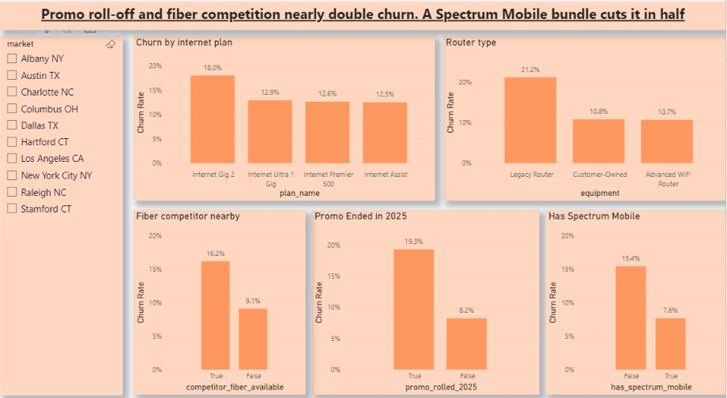
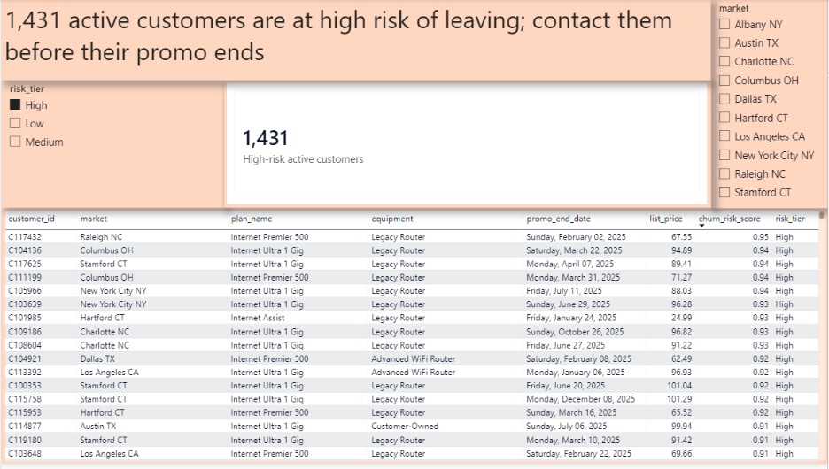

# Internet Churn & Retention Analysis

**Tools:** SQL (DuckDB) · Python (pandas, scikit-learn) · Power BI (DAX)
**Data:** 20,000 broadband subscribers, 227K monthly usage and billing records, 26K support tickets, and a 4,000-customer retention offer test. *All data is synthetic; not affiliated with Charter Communications.*

## Business problem
Broadband disconnects rose in 2025 as promotional prices ended and fiber competitors expanded. Retention leadership asked three questions:
1. Why are customers leaving?
2. Who is likely to leave next?
3. Which save offer is worth rolling out?

## Key results
| Metric | Result |
| --- | --- |
| 2025 churn rate | **13.2%** |
| Annual revenue lost | **$2.52M** |
| Churn model accuracy (AUC) | **0.90** |
| Churners captured in riskiest 20% | **74%** |
| Active customers flagged high-risk | **1,431** |
| Best save offer | **Free speed upgrade, $1,678 per save** |

## Dashboard

**Executive summary**: overall churn, monthly trend, churn by state

**Churn drivers**: promo roll-off and fiber competition nearly double churn; a Mobile bundle cuts it in half

**At-risk customers**: a prioritized call list for the retention team

**Offer test**: all three offers beat no offer; only the speed upgrade and discount
