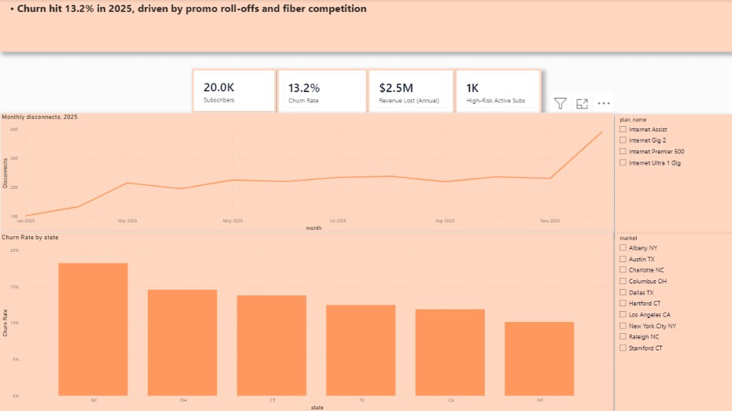
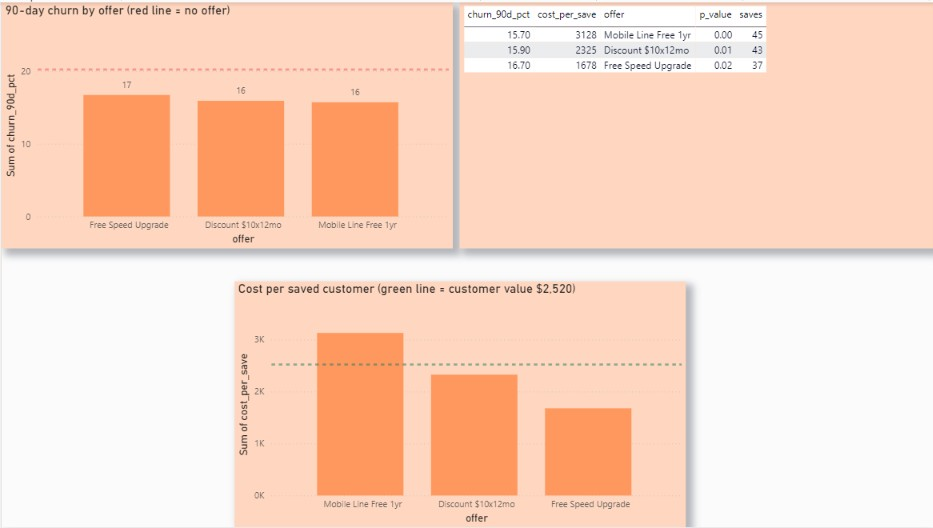

# Internet Churn & Retention Analysis

**Tools:** SQL (DuckDB) · Python (pandas, scikit-learn) · Power BI (DAX)
**Data:** 20,000 broadband subscribers, 227K monthly usage and billing records, 26K support tickets, and a 4,000-customer retention offer test. *All data is synthetic; not affiliated with Charter Communications.*

## Business problem
Broadband disconnects rose in 2025 as promotional prices ended and fiber competitors expanded. Retention leadership asked three questions:
1. Why are customers leaving?
2. Who is likely to leave next?
3. Which save offer is worth rolling out?

## Key results
| Metric | Result |
| --- | --- |
| 2025 churn rate | **13.2%** |
| Annual revenue lost | **$2.52M** |
| Churn model accuracy (AUC) | **0.90** |
| Churners captured in riskiest 20% | **74%** |
| Active customers flagged high-risk | **1,431** |
| Best save offer | **Free speed upgrade, $1,678 per save** |

## Dashboard

**Executive summary**: overall churn, monthly trend, churn by state

**Churn drivers**: promo roll-off and fiber competition nearly double churn; a Mobile bundle cuts it in half

**At-risk customers**: a prioritized call list for the retention team

**Offer test**: all three offers beat no offer; only the speed upgrade and discount pay for themselves

## What drives churn
| Factor | Churn with | Churn without |
| --- | --- | --- |
| Promo price ended in 2025 | 19.3% | 8.2% |
| Fiber competitor available | 16.2% | 9.1% |
| No Spectrum Mobile bundle | 15.4% | 7.6% |
| Legacy router | ~21% | ~11% |

The top stated reason for leaving was **"Price increase after promo" (~42%)**.

## Retention offer test (90-day churn)
| Offer | Churn | p-value | Cost per save |
| --- | --- | --- | --- |
| Control (no offer) | 20.2% | — | — |
| Free Mobile line, 1 yr | 15.7% | 0.004 | $3,128 |
| $10 off for 12 months | 15.9% | 0.006 | $2,325 |
| Free speed upgrade | 16.7% | 0.019 | $1,678 |

A saved customer is worth about **$2,520** (≈$70/month × 3 years).

## Recommendations
1. **Contact customers 30–45 days before their promo ends**, prioritized by churn risk score.
2. **Medium-risk customers:** offer the free speed upgrade (cheapest per save).
3. **High-risk customers in fiber markets:** offer the free Mobile line, since a bundle keeps customers longest.
4. **Replace legacy routers proactively:** they dominate the high-risk list.
5. **Skip offers for low-risk customers:** most would stay anyway.

## Data quality and analyst notes
- Removed 35 duplicate customers, standardized inconsistent market names, and filled 120 missing age bands.
- **December churn is inflated** by 189 churn dates capped at 12/31 (data cutoff); I'd confirm with the data owner before reporting it.
- **Target leakage:** excluded "Cancel Request" tickets from the model, because a cancel call is the outcome, not an early warning.
- Correlated features (router type, outages, disconnects) mean single coefficients shouldn't be read in isolation.

## Repository contents
- `notebooks/01_data_quality.ipynb`: profiling and cleaning
- `notebooks/02_churn_drivers.ipynb`: exploratory analysis
- `notebooks/03_churn_model.ipynb`: logistic regression and random forest, lift analysis, risk scoring
- `notebooks/04_offer_test.ipynb`: A/B test significance and cost per save
- `sql/churn_analysis.sql`: SQL walkthrough
- `dashboard/churn_dashboard.pbix`: Power BI file
- `outputs/`: exported tables used by the dashboard
