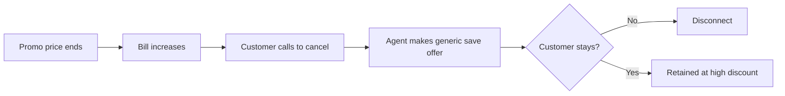
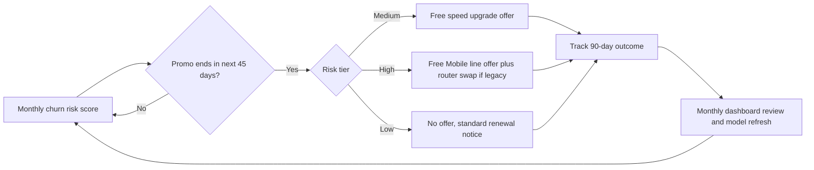

# Business Case: Risk-Based Retention Program

**Prepared for:** VP, Consumer Retention · **Prepared by:** Rajat Karki
*Portfolio project on synthetic data. Not affiliated with Charter Communications.*

## 1. Recommendation (summary)

Replace reactive, one-size-fits-all save offers with a **risk-based retention program**: score every customer monthly, contact Medium- and High-risk customers **30–45 days before their promo ends**, and match the offer to the risk tier. On the current customer base this is projected to **save ~430 customers a year and return ~$680K net**, versus a **~$230K loss** if the same offer were sent to everyone.

## 2. The problem

- 2025 broadband churn reached **13.2%**, putting **$2.52M** in annual recurring revenue at risk.
- The biggest drivers are things the business can act on before the customer calls to cancel:
  - Promo price ending: **19.3%** churn vs 8.2%
  - Fiber competitor available: **16.2%** vs 9.1%
  - No Mobile bundle: **15.4%** vs 7.6%
  - Legacy router: **~21%** vs ~11%
- Today, most save attempts happen only **after** the customer calls to cancel, when the decision is already made.

## 3. Options considered

Based on the 4,000-customer offer test, broken down by churn-risk tier. Values use about $2,520 per saved customer (≈$70/month × 3 years) over one year of offers.

| Option | What it is | Customers saved / yr | Offer cost / yr | Net value / yr |
| --- | --- | --- | --- | --- |
| A. Do nothing | Keep reactive saves only | 0 | $0 | $0 |
| B. Blanket offer | Free speed upgrade to every active customer | ~370 | ~$1.17M | **~ −$230K** |
| **C. Risk-based (recommended)** | Medium-risk → speed upgrade; High-risk → free Mobile line | **~430** | **~$420K** | **~ +$680K** |

**Why targeting matters:** low-risk customers almost never leave (under 1% churn), so offers to them are pure cost: about **$70K lost per 1,000 customers** contacted. The return comes from the Medium and High tiers.

### Offer return by risk tier (per 1,000 customers contacted)

| Risk tier | Best offer | Churn: no offer → offer | Saves | Net value |
| --- | --- | --- | --- | --- |
| Low (~11,500 active) | None | 0.5% → 0.5% | ~0 | Every offer loses money |
| Medium (~4,400 active) | Free speed upgrade | 12.4% → 7.3% | 51 | **+$62K** |
| High (1,431 active) | Free Mobile line, 1 yr | 63.0% → 48.3% | 147 | **+$283K** |

## 4. Current vs. proposed process

**Current: reactive**

**Proposed: proactive and risk-based**

## 5. Requirements

| # | Requirement | Owner |
| --- | --- | --- |
| R1 | Monthly churn risk score for every active customer, delivered as a list with tier and promo end date | Analytics |
| R2 | Outreach list of Medium/High-risk customers with promo ending in 30–45 days | Analytics → Retention Ops |
| R3 | Offer codes for speed upgrade and Mobile line, applied without a store visit | Product / Billing |
| R4 | Agent script and talking points per tier | Retention Ops |
| R5 | Holdout group (10% of eligible customers, no offer) to keep measuring true impact | Analytics |
| R6 | Dashboard tracking the KPIs below, refreshed monthly | Analytics |

## 6. KPIs and definitions

| KPI | Definition | Target (pilot) |
| --- | --- | --- |
| Promo roll-off churn | Customers who disconnect within 90 days of promo end ÷ customers whose promo ended | 19% → **16%** |
| Save rate | Holdout churn − treated churn | ≥ 4 points |
| Cost per save | Offer cost ÷ customers saved | Below **$2,520** |
| Net retention value | (Saves × $2,520) − offer cost | Positive by tier |
| Offer acceptance rate | Customers who accept ÷ customers contacted | Track (baseline) |

## 7. 90-day pilot plan

| Phase | Weeks | Activities |
| --- | --- | --- |
| Setup | 1–3 | Build monthly scoring job and outreach list; create offer codes; train agents |
| Pilot | 4–12 | Run in **Charlotte NC and Dallas TX** (high fiber competition); 10% holdout |
| Review | 13 | Compare treated vs holdout churn by tier; decide on national rollout |

**Go / no-go criteria:** promo roll-off churn down at least 3 points versus holdout, and cost per save below $2,520 in both targeted tiers.

## 8. Risks and assumptions

- **Small samples by tier:** the tier-level results come from about 300–550 customers per cell in the test, so the pilot is needed to confirm them before a national rollout.
- **Customer value assumption:** $2,520 assumes a ~3-year remaining life at ~$70/month; a shorter life lowers the return, which is another reason to target only Medium/High.
- **90-day window:** the test measured churn at 90 days; some saved customers may still leave later. Track at 6 and 12 months.
- **Mobile line economics:** the free Mobile line only pays off if customers keep paying for Mobile after year one. Track the conversion rate.
- **Model drift:** refresh the risk model quarterly as pricing and competition change.
